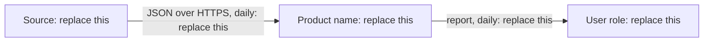
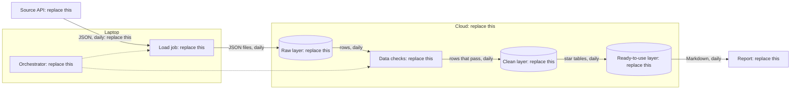
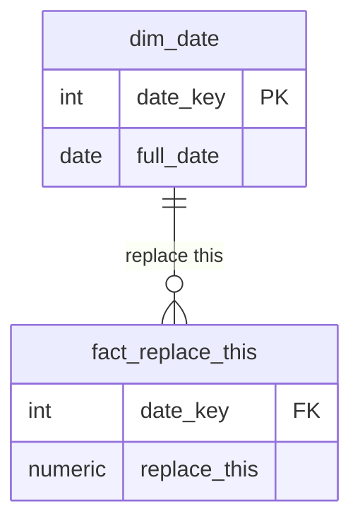

# Capstone plan: <your product name>

> **How to use this file.** In CP1 task 7, copy it to `capstone/PLAN.md` in your task folder. Each CP1 task from 7 to 15 fills one or two parts. The table "Which task fills which part" in the course kit's `capstone/README.md` lists them.
> Keep every `##` and `###` heading exactly as it is, in this order. The script that turns your approved plan into your own tasks finds each part by its heading.
> Lines that start with `>` are guidance. The script ignores them, so you may delete them or leave them. Replace every `<...>` and every "replace this".
> Never put real personal data in the plan: no real names, phone numbers, emails or addresses. Users have made-up first names.

Student code: <your student code>
Brief: <clean-hours | city-fix | river-rise | research-pulse | own idea>
Plan version: 1

## Product

> CP1 task 7. Write 3 to 5 sentences: the product's name, the problem, who has the problem, and your two reasons for choosing it.
> Then list at least three things your product will not do in the capstone.

<3 to 5 sentences>

Not in this capstone:

- <one thing your product will not do>
- <a second thing>
- <a third thing>

## Question and users

> CP1 task 8. One question in one sentence that ends with a question mark. Name what is measured, where, and over what period.
> Then write 2 to 4 example answers, as the user would read them.

Question: <your question?>

Example answers:

- <an answer as the user reads it>
- <a second answer>

### Users

> 1 to 3 users. Each has a made-up first name, a role, the decision they make with your answer, how often they make it, and the freshness they need (how old the data may be when they decide, for example "yesterday's data, ready by 07:00").

| Name (made up) | Role | Decision they make with the answer | How often | Freshness they need |
|---|---|---|---|---|
| <name> | <role> | <decision> | <how often> | <freshness> |

### Success measures

> Five measures, one per row, in this order. Each target is a number that a query or a test can check. "Fast", "accurate" and "cheap" are not targets.

| Measure | Target | How I will measure it | User need it serves |
|---|---|---|---|
| Freshness | <number> | <query or test> | <need> |
| Correctness | <number> | <query or test> | <need> |
| Completeness | <number> | <query or test> | <need> |
| The answer | <number> | <query or test> | <need> |
| Cost | <number> | <query or test> | <need> |

## Sources

> CP1 task 9. One `###` heading per source, named after it: one or two sources. Paste the `curl` status and the first lines of each address into `evidence.md` in the task folder.

### <source name>

- Address: <the data address you checked>
- Licence or terms: <name, with a link>
- Course use and credit: <one sentence: may you use it in a course project, and what must you credit?>
- Format: <JSON, CSV or other>
- Size of one day or one file: <bytes, from what you downloaded>
- Size of the history I will load: <the arithmetic, from the line above>
- How often it changes: <and whether old records change after they are published>
- Load method: <full or incremental; the watermark column or the date in the address; how you catch records that change later>
- Limits: <key, rate limit, page size, largest date range in one request, and how your loader stays inside them>
- Fallback: <what you do when the source is down for a day>

## Architecture

### Context

> CP1 task 10. Your sources on the left, your product as one box, your users on the right. Label every arrow with what flows and how often. Then write 2 or 3 sentences for someone new to your product.

<2 or 3 sentences>

### Pipeline

> One `subgraph` for the laptop and one for your chosen cloud. Every data store is a cylinder, one per layer (raw, clean, ready to use). Every job is a box. The orchestrator starts jobs with dotted arrows (`-.->`): data never flows through it. Put the data checks between layers, and the report or dashboard at the end. Label every arrow with the format and how often.

Stores and their technology:

- Raw layer: <for example "JSON files in an S3 bucket, by date">
- Clean layer: <technology>
- Ready-to-use layer: <technology>

## Data model

> CP1 task 10. The grain of your main fact table in one sentence: "One row per ... per ...". Then a Mermaid `erDiagram` with the fact, 2 to 4 dimensions and a date dimension. Mark keys `PK` and `FK`, give every column a type, and give every relationship its cardinality and a label.

Grain: One row per <...> per <...>.

- A question this model answers: <question>
- A question it cannot answer: <question, and why>
- A dimension that changes over time, and how I keep its history: <dimension and method>

## Data contract

> CP1 task 11. The contract for your main table lives in `contracts/<table>.yaml`, next to this file. Link it, then write 2 or 3 sentences: which check blocks a run, and who is told when the contract changes.

Contract: [contracts/<table>.yaml](contracts/<table>.yaml)

<2 or 3 sentences>

## Decisions

> CP1 task 12. Three decision records in `docs/decisions/`, next to this file. One line each: the link and the decision in a few words. One of the three decides where the data is stored, and on which cloud.

- [0001: <decision>](docs/decisions/0001-<short-name>.md): <the decision in a few words>
- [0002: <decision>](docs/decisions/0002-<short-name>.md): <the decision in a few words>
- [0003: <decision>](docs/decisions/0003-<short-name>.md): <the decision in a few words>

## Load and failure

### Today

> CP1 task 13. Rows a day, peak rows a second (five times the average), bytes a day and a year, and the freshness target. Show the arithmetic, starting from the sizes in `## Sources`. Round to one or two significant figures.

- Rows a day: <number, with the arithmetic>
- Peak rows a second: <number, with the arithmetic>
- Bytes a day and a year: <numbers, with the arithmetic>
- Freshness target: <from your success measures>

### Ten times the load

> Multiply each number by ten and follow one run through your pipeline diagram. Name the part that breaks first, what you would change, what the change costs, and why you do not build it now.

<your answer>

### Failures

> For each failure: what your design does, the key or step that keeps the data right, and the check or alert that tells someone.

| Failure | What my pipeline does | The key or step that keeps the data right | The alert |
|---|---|---|---|
| The source is down for two days | <backfill> | <key or step> | <alert> |
| The job crashes halfway through a load | <what happens> | <key or step> | <alert> |
| The same records arrive twice | <what happens> | <key or step> | <alert> |

## Cost

> CP1 task 14. State your assumptions, taken from `## Load and failure`. Price the design for a month on two clouds: a table for each, in US dollars, with the total in rupees. Then the cost of weeks 28 to 30 on the account you will use, the free allowance or credit that covers it, and the budget alarm. The Snowflake trial and the Azure free credit have ended by week 28. The AWS free plan, BigQuery's free allowance and Databricks Free Edition are still open.

Assumptions:

- Data stored after a year: <GB>
- Runs a day: <number>
- Compute minutes a run: <number>
- Queries a day: <number, and the bytes each scans>

**Cloud 1: <name and region>**

| Service | Size | Unit price | A month (USD) |
|---|---|---|---|
| <service> | <size> | <price> | <cost> |
| Total | | | <USD, and rupees> |

**Cloud 2: <name and region>**

| Service | Size | Unit price | A month (USD) |
|---|---|---|---|
| <service> | <size> | <price> | <cost> |
| Total | | | <USD, and rupees> |

Exchange rate and date: <for example ₹94.04 to the dollar on 12 November 2026>

Cost traps, and how my design avoids each:

- <trap 1>
- <trap 2>

Weeks 28 to 30: <the cost on the account you will use, and the allowance or credit that covers it>

Budget alarm: <the amount, and who gets the email>

My choice: <2 or 3 sentences: which cloud, why, and what would change your mind>

## Required parts

> CP1 task 7 fills "How my product does it". CP1 task 15 fills "Milestone" (M1, M2 or M3). Keep all seven rows, in this order.

| Required part | Taught in | How my product does it | Milestone |
|---|---|---|---|
| A question and a named user | CP1 | <how> | <M1, M2 or M3> |
| Ingestion that is safe to re-run | P4, P5 | <how> | <M1, M2 or M3> |
| A warehouse or lakehouse with a documented model | P3, P5, P7, P9 | <how> | <M1, M2 or M3> |
| Orchestration with retries and a backfill | P6 (also P10, P11) | <how> | <M1, M2 or M3> |
| Data tests that block bad data, and a data contract | P9, P13 | <how> | <M1, M2 or M3> |
| One real cloud, built with Terraform, with a cost note and a teardown | P10, P11 | <how> | <M1, M2 or M3> |
| Something a person can open: a report or a dashboard | LP, P14 | <how> | <M1, M2 or M3> |

## Milestones

### Backlog

> CP1 task 15. Work items of 1 to 3 hours each, most important first. ID W01, W02 and on. Required part: the row of `## Required parts` the item serves, or "none". Priority: Must, Should or Could. Hours: your likely hours plus 20%. Every required part needs at least one Must item.
> Each idea under `### Ideas the course has not taught me` gets a 1-hour item to learn it, in the milestone of the first item that needs it.

| ID | Work | Required part | Priority | Hours |
|---|---|---|---|---|
| W01 | <work> | <required part> | Must | <1 to 3> |

### M1 (week 28)

> About 18 hours: setup with tests on every push, ingestion that is safe to re-run, the storage layers and the core model. No item in M1 uses a coding agent.

- Items: <W01, W02 ...>
- Total hours: <number>
- At the demo I will show <one sentence>

### M2 (week 29)

> About 17 hours: the tables that answer your question, orchestration with retries and a backfill, the serving part, the cost note and the teardown script. Mark one item "with a coding agent", both here and in its backlog row: a small extension you build with an agent and log in `AGENT_LOG.md`.

- Items: <W.., W.. ...>
- Total hours: <number>
- At the demo I will show <one sentence>

### M3 (week 30)

> About 5 hours: fixes after the Gate 8 review, and one full run from empty on the real cloud.

- Items: <W.., W..>
- Total hours: <number>
- At the demo I will show <one sentence>

## Risks

> CP1 task 15. Three risks: what could go wrong, how likely it is (low, medium or high), and what you will do.

| Risk | How likely | What I will do |
|---|---|---|
| <risk> | <low, medium or high> | <response> |

### Ideas the course has not taught me

> Every idea your plan needs that no course task taught, one per line, at most three. Examples: building an HTTP API, Terraform on Google Cloud or Databricks, reading XML. A learn card comes before the first task that needs each one. Write "None" if there are none.

- <idea, or None>
